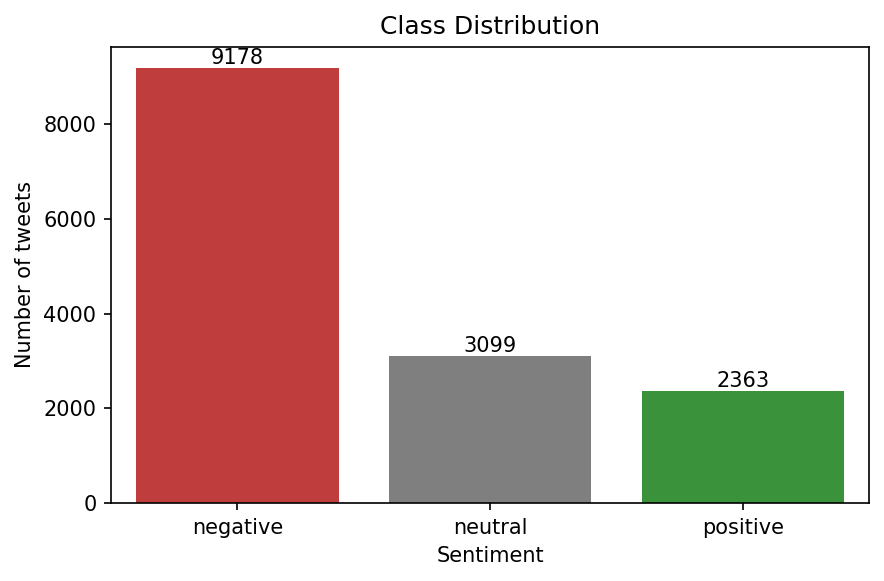
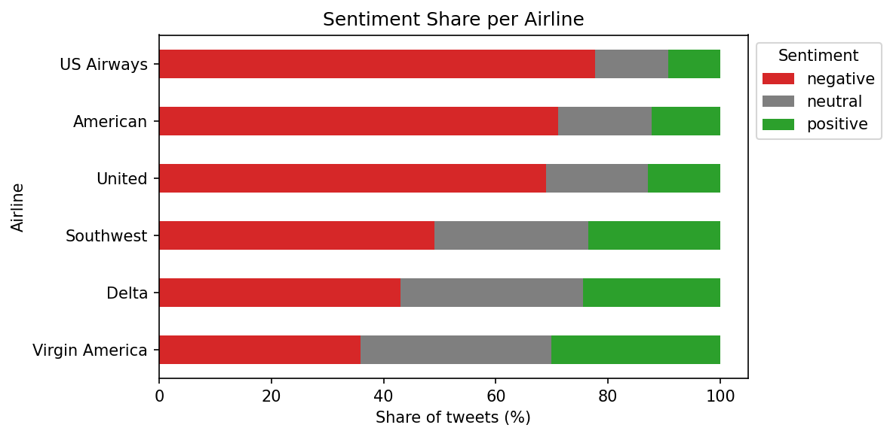
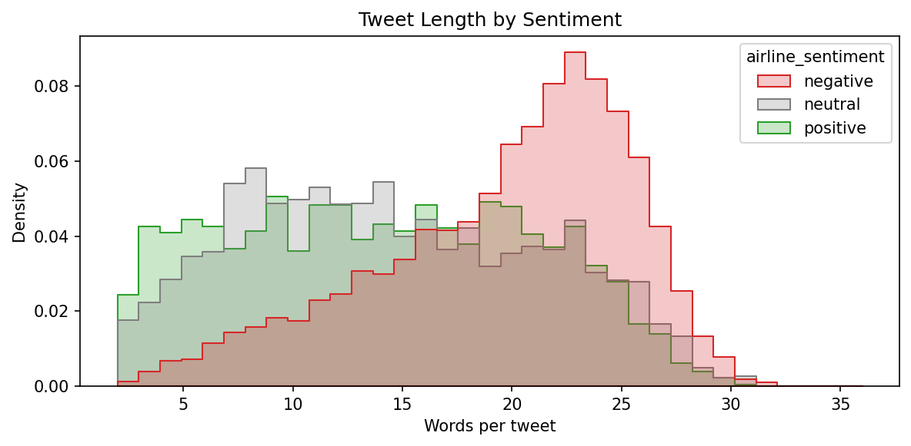
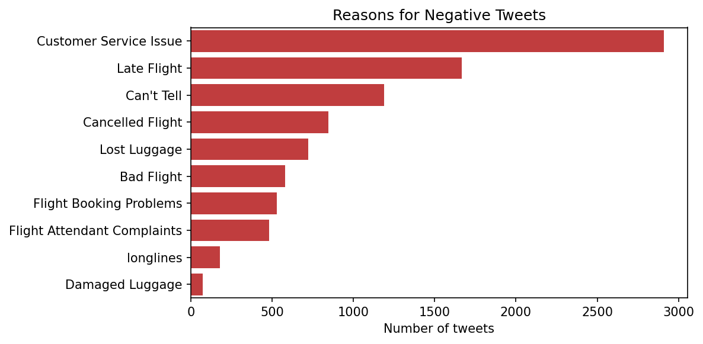
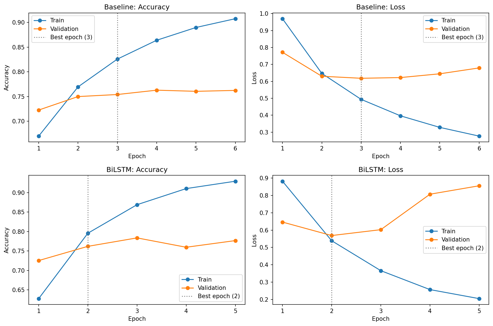
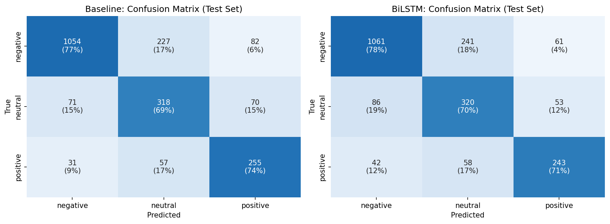
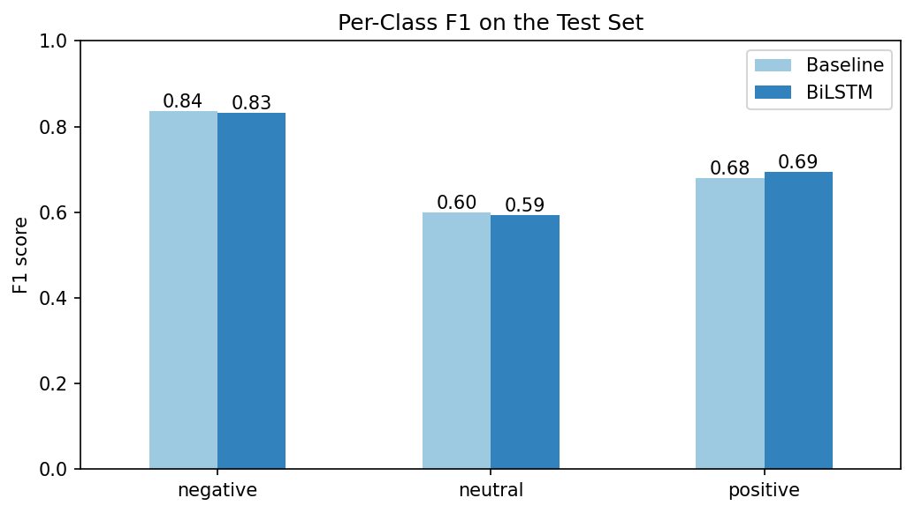
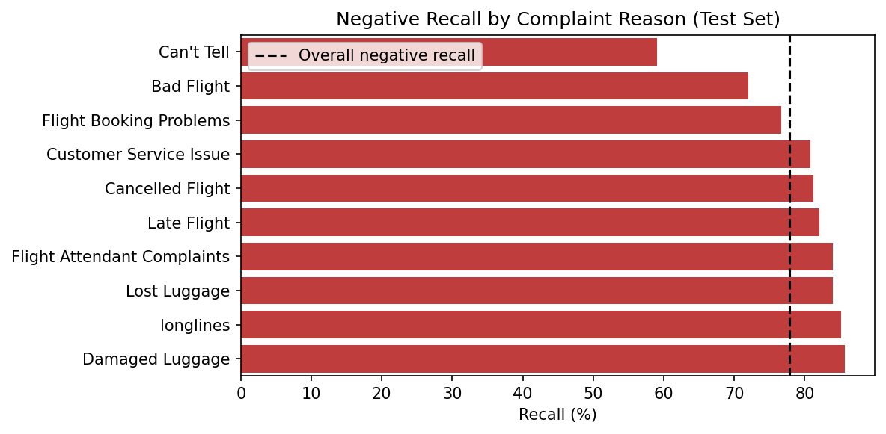

# Airline Tweet Sentiment Classification with Deep Learning

Classifies tweets sent to US airlines as **negative**, **neutral** or **positive** using deep learning (TensorFlow/Keras). An embedding + average-pooling baseline is compared against a bidirectional LSTM.

[](https://colab.research.google.com/github/WalidMWH/airline-sentiment-dl/blob/main/Airline_Sentiment_DL.ipynb)


## About the Task

This project was developed during my AI internship at **Software Persona**, for the assignment *"Machine Learning: Developing a Solution Suited to the Problem"*. The assignment asks for an end-to-end ML/DL solution to a real data problem: problem definition, data exploration (at least three visuals), preprocessing, a justified model choice, training, evaluation with suitable metrics, and an interpretation of the results including error analysis.

**Highlights**

| Item | Result |
| --- | --- |
| Dataset | 14,640 airline tweets, 3 imbalanced classes |
| Best macro F1 | 0.706 (majority-class reference: 0.258) |
| Accuracy | 75% |
| Key finding | Word order (BiLSTM) gave no gain over a bag-of-words baseline |
| Data issue found | A find-and-replace artifact in the dataset ("late" became "Late Flight") |

**Full report:** [Airline_Sentiment_Report_Walid_Halabi.pdf](report/Airline_Sentiment_Report_Walid_Halabi.pdf)

## Repository Structure

```
airline_sentiment_dl/
├── Airline_Sentiment_DL.ipynb   Full pipeline with outputs
├── figures/                     All charts used in this README
├── report/                      Final project report (PDF)
├── LICENSE
└── README.md
```

## How to Run

1. Download `Tweets.csv` from [Kaggle: Twitter US Airline Sentiment](https://www.kaggle.com/datasets/crowdflower/twitter-airline-sentiment). The dataset is not included in this repository.
2. Click the **Open In Colab** badge above, or open `Airline_Sentiment_DL.ipynb` in [Google Colab](https://colab.research.google.com/).
3. Select **Runtime > Change runtime type > T4 GPU**.
4. Select **Runtime > Run all** and upload `Tweets.csv` when prompted.

The whole notebook runs in under two minutes on a T4 GPU.

---

## 1. Problem Definition

Airlines receive thousands of tweets every day, and complaints need fast answers. This project builds a deep learning model that takes the text of a tweet as input and predicts its sentiment as negative, neutral or positive. With such a model, a customer service team can sort incoming tweets automatically and reach unhappy customers first. Because a missed complaint is costly, recall on the negative class matters as much as overall accuracy.

## 2. Dataset

The project uses the open [Twitter US Airline Sentiment](https://www.kaggle.com/datasets/crowdflower/twitter-airline-sentiment) dataset from Kaggle: 14,640 tweets addressed to six US airlines, each labeled by human annotators. The input is the `text` column and the target is `airline_sentiment`. The `airline` and `negativereason` columns are used only for analysis, never as model input.

| Class | Tweets | Share |
| --- | --- | --- |
| Negative | 9,178 | 62.7% |
| Neutral | 3,099 | 21.2% |
| Positive | 2,363 | 16.1% |



The classes are strongly imbalanced: there are 3.9 times more negative tweets than positive ones. A model that always predicts "negative" already reaches 62.7% accuracy, so macro F1 is used as the main metric. The data has no missing values, but it contains 213 duplicate tweets.

## 3. Data Analysis and Preprocessing

### 3.1 Exploration



The share of negative tweets ranges from about 36% for Virgin America to 78% for US Airways. The airline name alone therefore predicts sentiment, so a model could learn "@usairways means negative" instead of reading the content. To block this shortcut, all @mentions are removed during cleaning.



Negative tweets are clearly longer, at 19.7 words on average compared with 14.4 for neutral and 14.0 for positive tweets. Complaining customers explain their problem, while satisfied customers write a short thank-you. Since 95% of tweets have 27 words or fewer, the sequence length is set to 30 tokens.



Customer service issues (about 2,900 tweets) and late flights (about 1,650) are the most common complaints. About 1,190 negative tweets are labeled "Can't Tell": the annotators agreed the tweet was negative but could not say why. This is an early sign of label noise.

### 3.2 Preprocessing

1. **Duplicates removed.** 213 duplicate tweets were dropped so that no tweet can appear in both the training and test sets, leaving 14,427 tweets.
2. **Text cleaning.** Text is lowercased, HTML entities are decoded, and URLs and @mentions are removed. Hashtag symbols are removed but the words are kept. "!" and "?" are kept as separate tokens because they carry emotion. Stopwords are kept because words like "not" and "no" reverse sentiment; both are among the 25 most frequent tokens.
3. **Stratified split.** The data is split 70/15/15 into training (10,098), validation (2,164) and test (2,165) sets, each with the same class shares.
4. **Tokenization and padding.** A vocabulary of the 10,000 most frequent words is learned from the training set only, so the validation and test sets stay unseen. Each tweet becomes 30 word IDs; shorter tweets are padded with zeros and unknown words map to `[UNK]`.
5. **Class weights.** Balanced weights of 0.53 (negative), 1.57 (neutral) and 2.10 (positive) make mistakes on the rare classes cost more during training.

One limitation of this cleaning is that it deletes emojis, which often carry sentiment: "you guys are so clever 😃" becomes "you guys are so clever".

## 4. Model Design

Two deep learning models were built and compared to test one question: does reading word order help classify tweet sentiment? Both models share the same embedding input and classification head, and differ only in how they summarize the tweet.

| Layer | Baseline (bag of words) | BiLSTM (word order) |
| --- | --- | --- |
| Input | 30 word IDs | 30 word IDs |
| Embedding | 10,000 words to 64-dimensional vectors, padding masked | Same |
| Sequence summary | Global average pooling: averages the word vectors and ignores order | Bidirectional LSTM, 64 units per direction: reads the tweet forwards and backwards (128 outputs) |
| Regularization | Dropout 0.3 | Dropout 0.4 |
| Hidden layer | Dense, 32 units, ReLU | Dense, 32 units, ReLU |
| Regularization | Dropout 0.3 | Dropout 0.4 |
| Output | Dense, 3 units, softmax | Dense, 3 units, softmax |
| Trainable parameters | 642,179 | 710,275 |

**Why these choices:**

- **Embedding layer.** It learns a dense vector for each word, so words with similar meaning end up close together. Masking makes later layers ignore the padding zeros.
- **Baseline with average pooling.** A fast and simple reference. Since it treats a tweet as a bag of words, it cannot tell "not good" from "good".
- **Bidirectional LSTM.** It reads the tweet in sequence, so each word is seen with the context on both sides. This should help with negations such as "not good at all".
- **ReLU** is used in the hidden layer, and **softmax** in the output layer to give three class probabilities that sum to 1.
- **Loss: sparse categorical cross-entropy**, the standard loss for multi-class problems with integer labels.
- **Optimizer: Adam** with a learning rate of 0.001, a reliable default that adapts the step size for each weight.
- **Dropout** is used because about 90% of the parameters sit in the embedding layer, which makes overfitting likely on a dataset of about 10,000 training tweets.

## 5. Training

Both models were trained in Google Colab on a T4 GPU with TensorFlow 2.21, using a fixed random seed (42) for reproducibility.

| Setting | Value |
| --- | --- |
| Maximum epochs | 30 |
| Batch size | 64 (158 weight updates per epoch) |
| Validation | Separate 15% validation set, checked after every epoch |
| Early stopping | Monitors validation loss, patience of 3 epochs, restores the best weights |
| Class weights | 0.53 / 1.57 / 2.10 (negative / neutral / positive) |



Both models overfit quickly. Training accuracy climbs above 0.90 while validation accuracy stays around 0.76, and validation loss starts rising after epoch 2 or 3. Early stopping restored epoch 3 for the baseline (validation loss 0.618, 10 seconds of training) and epoch 2 for the BiLSTM (validation loss 0.569, 14 seconds).

Validation loss was monitored instead of accuracy for a reason. At BiLSTM epoch 3, validation accuracy rose to 0.784, but validation loss also rose. The model got a few more tweets right, but became overconfident on the ones it got wrong. Loss detects this loss of reliability earlier than accuracy does.

## 6. Evaluation Results

Both models nearly triple the macro F1 of the majority-class reference (0.258 to about 0.705), but the BiLSTM is no better than the much simpler baseline. All results are on the 2,165 test tweets, which were used only once.

| Model | Accuracy | Macro precision | Macro recall | Macro F1 | Weighted F1 |
| --- | --- | --- | --- | --- | --- |
| Majority class (always negative) | 0.630 | 0.210 | 0.333 | 0.258 | 0.486 |
| Baseline | 0.752 | 0.689 | 0.737 | 0.705 | 0.762 |
| BiLSTM | 0.750 | 0.697 | 0.728 | 0.706 | 0.759 |

| Class | Baseline precision | Baseline recall | Baseline F1 | BiLSTM precision | BiLSTM recall | BiLSTM F1 |
| --- | --- | --- | --- | --- | --- | --- |
| Negative (1,363 tweets) | 0.912 | 0.773 | 0.837 | 0.892 | 0.778 | 0.832 |
| Neutral (459 tweets) | 0.528 | 0.693 | 0.599 | 0.517 | 0.697 | 0.594 |
| Positive (343 tweets) | 0.627 | 0.743 | 0.680 | 0.681 | 0.708 | 0.694 |





- **Word order did not help.** The difference of 0.001 in macro F1 is within the noise of a single run. Tweets are short, and their sentiment is carried mainly by keywords such as "thanks", "delayed" or "worst", which a bag-of-words model already captures. The simpler baseline is therefore the better choice: it is as accurate and trains faster.
- **Neutral is the weakest class (F1 about 0.60).** Only about half of the "neutral" predictions are correct. The largest single error is negative tweets predicted as neutral (241 tweets for the BiLSTM). The higher class weight on neutral (1.57 compared with 0.53) pushes uncertain tweets toward it, and polite complaints such as "can you help me rebook?" sound neutral.
- **Negative tweets: high precision, lower recall.** When a model says "negative" it is right about 90% of the time, but it misses about one complaint in four. For an airline that wants to reach every unhappy customer, negative recall is the most important number to improve.
- **Opposite sentiments are rarely confused.** Negative and positive are mixed up in only 4% to 12% of cases. Most errors involve the neighboring neutral class, so the models understand polarity but struggle with intensity.

## 7. Error Analysis

About half of the model's most confident mistakes are labeling problems, not model failures. The BiLSTM misclassified 541 of 2,165 test tweets (25.0%), and 81% of these errors (438) involve the neutral class.

### 7.1 The most confident mistakes

The 15 errors with the highest model confidence (0.95 to 0.99) were read one by one and grouped:

| Category | Count | Example tweet (true label, predicted label) |
| --- | --- | --- |
| Wrong or debatable label | 7 | "sitting on a plane in Philadelphia for over 20 minutes waiting just to get off the plane. Great service!" (positive, negative): sarcasm the human annotator missed, so the model is right |
| Mixed sentiment | 2 | "That made me so mad, but then I called the bag number, and that person was helpful" (positive, negative) |
| Complaint phrased as a question | 2 | "How do we add guitars and instruments to the list?" (negative, neutral) |
| Rare words or hashtags | 2 | "Mold on my flight?!? #filthyplane" (negative, neutral): "filthyplane" is unknown to the vocabulary |
| Dataset artifact | 1 | "I need to leave from Hawaii Late Flight evening" (neutral, negative) |
| Ambiguous even for humans | 1 | "a percentage on every plastic bottle ... turn up the heat" (neutral, negative) |

Label noise puts a ceiling on the accuracy any model can reach on this dataset. It also means the real performance of the model is somewhat underestimated.

### 7.2 Which complaints are missed



The model finds explicit complaints well. Damaged luggage, long lines, lost luggage and late flights all reach 82% to 86% recall, because they come with clear keywords like "lost my bag" or "delayed". Vague complaints are missed more often: "Bad Flight" reaches 72% and "Can't Tell" only 59%. When the annotators could not say why a tweet was negative, the model struggles too.

### 7.3 A preprocessing artifact in the dataset

The error analysis revealed that the published tweets were altered by a find-and-replace: the word "late" was replaced with "Late Flight" and "cancel" with "Cancelled Flight", matching two complaint category names. This affects 447 and 999 tweets respectively and creates words such as "Late Flightr" (from "later") and "Cancelled Flighted" (from "canceled"). As a result, neutral sentences like "late evening" receive a false negative signal. Even well-known public datasets can contain such artifacts, and only reading the errors revealed it.

## 8. Conclusion and Improvements

Both deep learning models classify airline tweets with a macro F1 of about 0.71 and 75% accuracy, far above the 0.26 macro F1 of a majority-class guess. The bidirectional LSTM gave no gain over a simple bag-of-words baseline, so the baseline is the recommended model: it is equally accurate, smaller and faster. The main weaknesses are the neutral class and the one in four complaints that is missed, and a large part of the remaining error comes from noisy labels and a dataset artifact rather than from the model.

Suggested improvements, ordered by the errors they address:

1. **Undo the dataset artifact** by replacing "Late Flight" with "late" and "Cancelled Flight" with "cancel" before training.
2. **Keep emojis and split hashtags.** Converting emojis to words (for example "grinning face") and splitting hashtags such as "#filthyplane" into "filthy plane" would recover lost sentiment signals.
3. **Use pretrained word embeddings** such as GloVe trained on tweets. This would reduce overfitting, since the embedding currently holds about 90% of the parameters and is learned from only about 10,000 tweets.
4. **Tune the decision threshold for the negative class** to raise negative recall, at a small cost in precision, which matches the goal of reaching every unhappy customer.
5. **Try a pretrained transformer** such as BERT, which understands context, negation and some sarcasm much better than models trained from scratch.
6. **Relabel or filter noisy examples.** The dataset includes an annotator confidence score that could be used to drop or down-weight uncertain labels.

---

**Author:** Walid Halabi ([@WalidMWH](https://github.com/WalidMWH)) · AI Engineering student, Bahçeşehir University

**Dataset:** [Twitter US Airline Sentiment](https://www.kaggle.com/datasets/crowdflower/twitter-airline-sentiment), originally published by Figure Eight (CrowdFlower), via Kaggle. The dataset is subject to its own license on Kaggle.

**License:** The code in this repository is released under the [MIT License](LICENSE).
